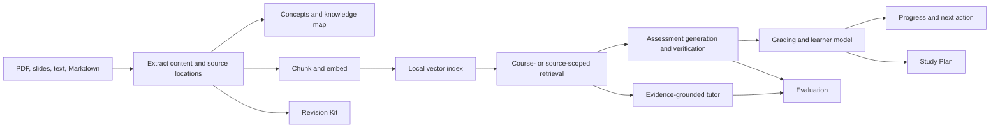

# AdaptiveLearn AI

**AdaptiveLearn AI is a course-grounded learning workspace that turns study materials into a connected path from understanding to practice.** Learners can explore concepts, ask questions with source evidence, take adaptive assessments, plan study sessions, and create revision materials in one place.

Built for the **2026 Multimodal AI Hackathon — Track D**.

## What it does

- **Indexes course material:** Import PDF, PowerPoint, text, and Markdown sources. PDF pages and PowerPoint slides are analyzed with their text and supported visual content. Extracted content retains source locations for later review.
- **Maps course knowledge:** Explore uploaded sources, topics, concepts, and prerequisite relationships in a knowledge map. Relationships appear when supported by extracted material.
- **Answers with evidence:** Ask the AI Tutor questions across the course or about a selected source. Responses include excerpts and source locations; unsupported questions are identified instead of answered as fact. Gemini mode supports English, Hindi, and Hinglish.
- **Adapts assessment:** Start with a diagnostic or practice by course, topic, or source. Supported question types include multiple choice, short answer, and numerical problems. Generated questions are checked against their evidence, and learner responses update concept-level progress.
- **Tracks learning:** Review mastery, confidence, misconceptions, recent answers, and recommended next actions across Overview and Learning Progress.
- **Plans study time:** Build a schedule around an exam date, available weekdays, and a daily time budget. The plan prioritizes prerequisites and concepts with lower mastery, and tracks completed sessions.
- **Creates revision materials:** Generate source-specific summaries, key points, and flashcards with evidence locations. Revision Kits can be downloaded as Markdown.
- **Evaluates quality:** Run a regression suite, review PDF benchmark drafts, inspect extraction labels, and export approved cases for RAGAS metrics.

## How the learning flow works



## Architecture

```text
React + TypeScript client (Vite)
  ├─ PDF.js and JSZip source parsing
  ├─ Gemini-backed extraction, embeddings, tutor, and assessment
  ├─ Browser localStorage: learner state, map data, plans, revision kits
  └─ Express API (port 3001)
       ├─ Gemini API proxy
       ├─ server/data/vectors.json: local vector index
       └─ server/data/sources/: uploaded source files
```

The client extracts source content and keeps its page, slide, or section metadata as it is indexed. The configured Gemini embedding model creates vectors. The Express service persists vectors and original source files locally. Retrieval can be limited to the course or selected sources. Tutor evidence references are built from retrieved chunk metadata, so source labels and locations come from indexed material.

The learner model uses deterministic mastery and confidence updates rather than Bayesian Knowledge Tracing. Assessment grading uses answer keys for multiple choice, required keywords for short answers, and a configured tolerance for numerical responses.

## Getting started

### Requirements

- A recent Node.js LTS release and npm
- A Gemini API key for Gemini-backed features

### Install and configure

```bash
npm install
```

Copy `.env.example` to `.env`, then add your Gemini API key. On PowerShell, use `Copy-Item .env.example .env`.

```dotenv
GEMINI_API_KEY=your_gemini_api_key_here
GEMINI_MODEL=gemini-2.5-flash
GEMINI_VERIFIER_MODEL=gemini-2.5-flash
GEMINI_EMBEDDING_MODEL=text-embedding-004
VITE_LLM_PROVIDER=gemini
VITE_EMBEDDING_PROVIDER=gemini
VITE_VECTOR_STORE=persistent
PORT=3001
```

Keep the real API key in `.env`; never commit it.

### Run locally

```bash
npm run dev
```

This starts the Vite client at `http://localhost:5173` and the Express API at `http://localhost:3001`.

## Useful commands

| Command | Purpose |
| --- | --- |
| `npm run dev` | Start the client and API for local development |
| `npm run build` | Type-check and create a production client build |
| `npm run preview` | Preview the built client |
| `npm run lint` | Run Oxlint |

## Evaluation and review

The Evaluation page combines deterministic regression checks with course-material benchmarks. A PDF benchmark can be drafted from indexed pages, but its questions and evidence labels must be reviewed and approved before scoring. Retrieval metrics use labeled evidence. Optional Gemini judge scores are estimates and are reported separately. Extraction-review labels can measure concept and prerequisite extraction, and approved benchmark cases can be exported for RAGAS Faithfulness, Answer Relevancy, Context Precision, and Context Recall.

The built-in learner simulations are test scenarios, not real learner studies. Their results should not be presented as proof of learning gains.

## Current boundaries

- The app currently uses one configured course and has no account system or multi-user sign-in.
- Source files and vectors are stored locally by the API. Learner state, plans, map data, and revision kits are stored in the browser. Data does not sync across devices.
- Short-answer grading uses keyword rules, not semantic human grading. Numerical questions are generated only when the source supports a solvable task.
- Mastery updates use deterministic heuristics. Learner self-report is a small signal, not proof of understanding.
- Extracted concept links and generated revision content can contain errors; review them against the original source.
- Gemini-backed features require a valid API key and provider configuration.

## Project documentation

- [Architecture and data flow](docs/ARCHITECTURE.md)
- [Course-material evaluation workflow](docs/COURSE_MATERIAL_EVALUATION.md)
- [Evaluation results and limitations](docs/EVALUATION_RESULTS.md)
- [Hackathon requirement coverage](docs/HACKATHON_REQUIREMENTS.md)
